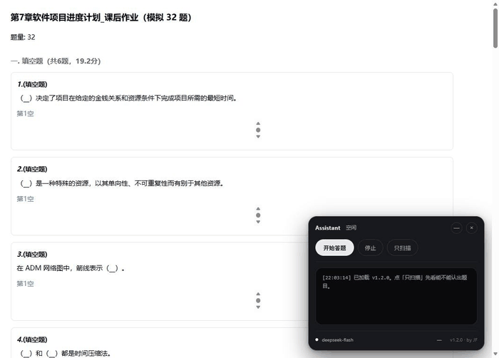

# Assistant · 答题助手（MV3） · v1.2.0

扫描页面题目 → 调用你的 OpenAI 兼容接口 → 自动填充答案。默认**不自动交卷**。



> 演示：加载扩展 → 「只扫描」识别 32 题 → 「开始答题」逐题填充 → 底部显示本次消耗（32 题 · 10.8k tok · ≈$0.0013）→ 切换三套主题

> 作者：**JF** ｜ 许可：MIT ｜ 适用：学习通 / 超星等常见课程平台的作业与测验页
> 版本以 `manifest.json` 为唯一真源，其余位置的版本号由 `test/version_check.mjs` 校验

- 纯前端，无后端、无遥测、无第三方上报
- 只请求你填的那个地址（默认 `127.0.0.1`）
- 支持：单选、判断、多选、填空（多空）、简答/其它（富文本编辑器）
- **用量与费用**：每题显示 token 与估算花费，面板底部汇总本次，弹窗看今日，可查 API 余额
- **图片题**：题干里的流程图 / 网络图 / 表格会一起发给支持视觉的模型（默认开）
- **已有答案默认"忽略重答"**：不管页面上原来的选择，按模型答案重新作答（可选「先判卷」或「跳过」）
- **三套主题**：石墨（默认）/ 纸白 / 墨蓝，设置页即时切换
- 认不出题目时可自定义选择器
- 内置假接口 + 模拟作业页，可离线自测

---

## 一、安装（Edge / Chrome 都一样）

1. 打开 `edge://extensions`（Chrome 用 `chrome://extensions`）
2. 右上角打开 **开发者模式**
3. 点 **加载解压缩的扩展** → 选中本文件夹 `chaoxing-ai`
4. 装好后工具栏出现图标，点「设置」填接口

> 改了代码后回到扩展页点一下「重新加载」（↻）即可。

## 二、配置本地模型

点扩展图标 → 设置 → 填 Base URL：

| 你用的东西 | Base URL | 模型名 | Key |
|---|---|---|---|
| **DeepSeek 官方**（默认） | `https://api.deepseek.com/v1` | `deepseek-flash` / `deepseek-v4-pro` | 必填 `sk-...` |
| **Ollama** | `http://127.0.0.1:11434/v1` | 本地模型名 | 留空 |
| **LM Studio** | `http://127.0.0.1:1234/v1` | 本地模型名 | 留空 |
| **vLLM** | `http://127.0.0.1:8000/v1` | `--served-model-name` | 看部署 |
| **one-api / new-api** | `http://127.0.0.1:3000/v1` | 渠道里的模型名 | 渠道 Key |

没有 key 先去 <https://platform.deepseek.com> 建一个。填完点 **测试连接**，能看到「连接成功，可用模型 N 个」就通了。

### DeepSeek 官方模型 id

| 模型 id | 实际版本 | 上下文 | 输入（缓存未命中） | 输出 |
|---|---|---|---|---|
| `deepseek-flash` | **DeepSeek-V4.1-Flash-1017** | 1M / 384K 输出 | $0.15（off-peak）/ $0.3（peak） | $0.6 / $1.2 |
| `deepseek-v4-pro` | DeepSeek-V4-Pro-0813 | 1M | $0.66 / $1.32 | $1.98 / $3.96 |

单位：每 1M tokens。旧名 `deepseek-v4-flash` 仍被接受，实际同样路由到 V4.1-Flash；写成 `deepseek-v4.1-flash` 无效。

**思考模式**（`thinking`）：默认关。开启后先输出思维链再给答案，计算题/简答题更准，但输出 token 翻几倍，且该模式下官方忽略 `temperature`。

**JSON 模式**默认开（`response_format: json_object`），答案结构最稳，别关。

先确认 key 有效（PowerShell，把 `sk-xxx` 换成你的）：

```powershell
curl.exe -s https://api.deepseek.com/v1/models -H "Authorization: Bearer sk-xxx"
```
返回模型列表 = key 可用；返回 `Authentication Fails` = key 不对或没激活。

Ollama 设置跨域（PowerShell，一次性）：
```powershell
setx OLLAMA_ORIGINS "*"
# 然后退出并重启 Ollama
```

## 三、用

1. 打开作业/考试页面（`*.chaoxing.com`）
2. 右下角出现「AI 答题」面板
3. 先点 **只扫描** —— 日志里应打印「扫到 N 题：single, judge, …」
4. 没问题就点 **开始答题**，逐题填充，每题间隔可调（默认 800ms）
5. 填完自己检查一遍再交

面板说明：

- **只在顶层页面出现一个**，iframe 里的题目照样能答（子框架静默执行，日志带 `[子框架]` 前缀回传）
- 可**拖动**（按住标题栏），位置会记住
- 「—」折叠，「×」关闭（关掉后点工具栏图标可重新调出）
- 日志最多保留 300 行

## 四、离线自测（不碰真作业）

```bash
# 窗口 1：起假接口
python test/mock_api.py          # http://127.0.0.1:8765/v1

# 窗口 2：起测试页
python -m http.server 8777 -d test
# 打开 http://127.0.0.1:8777/fixture.html
```
设置里 Base URL 改成 `http://127.0.0.1:8765/v1`、模型 `mock-answerer`，然后扫描 + 开始，5 题应全填对。

纯 DOM 逻辑还能离线跑（不需要浏览器）：
```bash
npm i -D jsdom
node test/dom_test.mjs      # 断言 6 项
```

**真浏览器端到端**（自动加载扩展 → 打开测试页 → 点扫描/答题 → 断言页面状态）：
```bash
npm i -D playwright-core
# 先起上面两个服务（8765 + 8777）
node test/e2e_browser.mjs   # 普通页面，断言 6 项
node test/e2e_iframe.mjs    # iframe 页面，断言「只有 1 个面板」+ 子框架能填
```
它用临时 Edge 配置文件 + `--load-extension` 启动，不影响你日常浏览器的设置。

## 五、认不出题目怎么办

学习通的 DOM 有几个版本，内置规则覆盖了常见的 `.questionLi` / `.TiMu` / `.singleQuesId`。如果「只扫描」是 0 题：

1. 在那页按 F12 → 检查元素，找到题目的外层容器、题干、选项各自的 class
2. 设置页最下面「自定义选择器」逐项填，例如
   - 题目容器：`.questionLi`
   - 题干：`.Zy_TItle`
   - 选项：`.Zy_ulTop li`
3. 保存 → 刷新页面 → 再扫描

自定义选择器会**排在内置规则之前**，所以填错了也不会崩。

## 六、行为开关

| 开关 | 默认 | 说明 |
|---|---|---|
| 自动填充 | 开 | 关掉只显示 AI 答案在日志里，不动页面 |
| 已有答案处理 | **忽略重答** | `overwrite`=重新作答（默认）；`check`=先判卷，正确保留/错误更正；`skip`=一律不动 |
| 判卷最小置信度 | 0.7 | 仅「先判卷」模式生效：置信度低于此值时保留原答案 |
| 自动下一题 | 关 | 每页只有一题时用 |
| 自动交卷 | **关** | 打开后会点「交卷/提交作业」 |
| 每题间隔 | 800ms | 太小容易被判定异常行为 |
| 最多题数 | 200 | 上限保护 |

## 七、目录

```
chaoxing-ai/
├── manifest.json      MV3 清单
├── background.js      service worker：配置 + 调接口 + 解析答案 JSON
├── content.js         扫题/提取/回填/HUD
├── content.css        HUD 样式
├── popup.html/js      工具栏弹窗（状态/开始/设置）
├── options.html/js    设置页（接口、行为、自定义选择器）
├── icons/             16/48/128
└── test/
    ├── fixture.html   模拟作业页（5 题五种题型）
    ├── mock_api.py    假 OpenAI 接口
    └── dom_test.mjs   jsdom 离线断言
```

## 八、注意

- 纯前端调用大模型的答案质量取决于你本地模型，7B 以下的模型在专业题上错误率不低，**交之前自己过一遍**。
- 有些题型（连线、拖拽、编程题、带图表的计算题）没有可点的选项，本插件只处理纯文本题型。
- 题库类页面如果题目在 iframe 里，`all_frames: true` 已开，HUD 会出现在各个 frame 中，注意点对面板。


---

## 适配细节（v1.8.0，按真实 mooc1/mooc2 DOM 校准）

| 真实结构 | 处理方式 |
|---|---|
| `<div class="questionLi" typename="单选题">` | 容器；`typename` 直接决定题型 |
| `<div class="answerBg" role="radio" onclick="addChoice(this)">` | 选项；点它触发超星自己的选中逻辑 |
| `<span data="A" class="num_option">` | 选项字母 |
| `<span class="tiankong">第1空</span>` + `.edui-editor iframe` | 填空题空位与对应编辑器 |
| `<div class="TiMu">` 包住全部题 | 视为包裹层，不计入题数（修掉 +1） |
| `typename="其它"` | 映射为简答题（走富文本编辑器） |
| 隐藏的模板 `.questionLi` | `display:none` 直接排除 |

**选项点击是幂等的**：超星的 `addChoice()` 是切换语义，点已选中的选项会取消它。所以实现里先判断“是否已选中”（`aria-checked` / `.checked` / `input.checked`），已选中就跳过点击；点完再复核一次，没选中才补置位。这样重复运行不会把答案点没。

**填空/简答写入方式**：优先用 `execCommand('insertText')` 做真实编辑 → 触发 `input/keyup/blur` → 再调用页面里的 `$EDITORUI[id].sync()` / `UE.getEditor(id).sync()`，让内容同步回隐藏域。

## 测试覆盖（40 条断言，全部通过）

| 套件 | 内容 | 结果 |
|---|---|---|
| `test/dom_test.mjs` | jsdom 扫题/回填逻辑 | 6/6 |
| `test/e2e_browser.mjs` | 真 Edge 加载扩展，5 题 | 6/6 |
| `test/e2e_iframe.mjs` | iframe 页面，面板唯一性 + 子框架填充 | 5/5 |
| `test/e2e_chaoxing.mjs` | 22 题（10单选/3填空/8判断/1简答）+ 包裹层 + 隐藏模板 | 6/6 |
| `test/e2e_real31.mjs` | **照第7章真实结构造的 31 题**（11单选/6填空9空/11判断/3其它） | 10/10 |

## 已知边界

1. **真实 DeepSeek 调用**未在交付前跑过（需要你的 API Key）；模型 id 与请求格式已按官方文档校准。
2. **提交后的服务端同步**无法在不交卷的前提下验证；已用 `execCommand` + `$EDITORUI.sync()` 双保险。
3. 连线题、拖拽题、带图片的计算题不在支持范围（无文本选项可选）。

---

## 声明

### 1. 用途与免责

本扩展是**录入辅助工具**：它读取页面上的题目，调用你在设置里配置的模型接口生成答案，再回填到页面。它不生产知识，也不保证答案正确。

- 模型可能给出**错误、过时或不适用**的答案；专业题、计算题尤其如此
- **提交前请自行核对每一道题**，这是使用本工具的前提
- 使用本工具产生的成绩、学分、考核结果等学业后果，由使用者自行承担
- 因浏览器或平台页面结构变更导致的功能失效、答案错位、数据异常，作者不承担赔偿责任
- 请遵守所在平台的服务条款与所在机构的学术规范；本工具不鼓励也不支持任何违反上述条款的行为

本软件按「现状」提供，不附带任何明示或暗示的担保。作者不对使用本软件造成的直接或间接损失负责。

### 2. 数据与隐私

| 项 | 说明 |
|---|---|
| 收集个人数据 | **不收集** |
| 埋点 / 统计 / 上报 | **无** |
| 账号密码 / Cookie | **不读取、不存储、不传输** |
| 发送到模型的内容 | 题干、选项，以及（仅在「先判卷」模式下）页面上已有的答案 |
| 发送目的地 | **仅**你在设置里填写的接口地址，默认 `https://api.deepseek.com/v1`，也可指向本地服务 |
| API Key 存放 | 仅保存在浏览器 `chrome.storage.sync`，随浏览器账号同步，不外传 |
| 本地保存的其他数据 | 主题、接口配置、面板位置、提示是否已读 |
| 全部网络请求 | 只有一条：`POST {你的 BaseURL}/chat/completions` |

扩展没有自建服务器，没有中转，代码可在本仓库逐行审阅。

### 3. 第三方与商标

本扩展由个人开发，与**超星、学习通、DeepSeek** 或其他任何平台、公司均无隶属、代理、合作或背书关系，未获其授权。

名称与界面中**不包含**上述平台的商标；文档中提及平台名称仅用于说明适用范围与兼容性。第三方开发依赖见 [NOTICE.md](NOTICE.md)。

### 4. 许可

源代码以 **MIT License** 发布，全文见 [LICENSE](LICENSE)。你可以自由使用、修改、再分发，但需保留版权声明；作者不提供任何担保。

### 5. 反馈

发现问题或页面结构变更导致失效，请在仓库提 issue，附上：
浏览器版本、扩展版本、页面类型（作业/测验/考试）、以及面板日志里出错的那几行。

